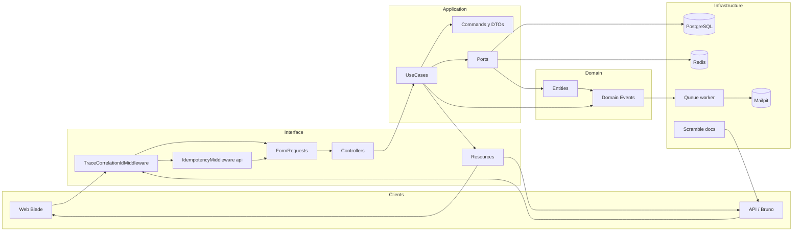
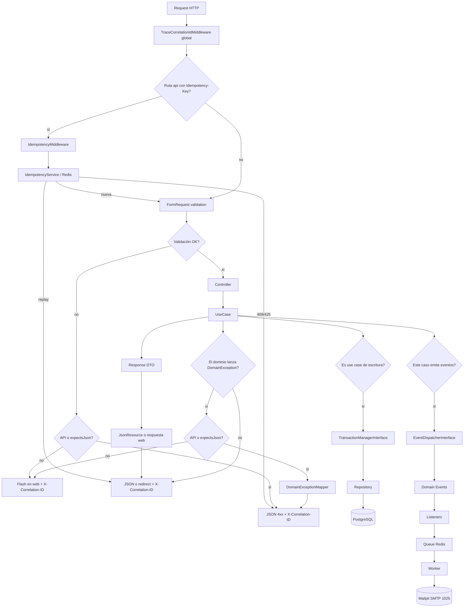

# IAM Boilerplate

<p align="center">
  <a href="https://github.com/Mii-17/Boilerplate/actions/workflows/ci.yml">
    
  </a>
  
</p>

> El badge `CI/CD` muestra el estado real del workflow `Continuous Integration` en `main` y enlaza con su historial de ejecuciones.

Boilerplate Laravel preparado para construir APIs y aplicaciones web con arquitectura hexagonal, DDD y TDD. Incluye autenticación IAM con Sanctum, verificación de correo, idempotencia, correlation IDs, documentación OpenAPI generada con Scramble y una colección Bruno ejecutable.

Estado actual de calidad: **93.5% de cobertura**, Pint y PHPStan nivel 9 en verde, 236 tests y 598 assertions.

## Arranque rápido

```sh
docker compose up -d --build
```

| Recurso | URL |
| --- | --- |
| Aplicación / API | http://localhost:8080 |
| Health check | http://localhost:8080/up |
| Documentación OpenAPI | http://localhost:8080/docs/api |
| Especificación JSON | http://localhost:8080/docs/api.json |
| Mailpit UI | http://localhost:8025 |
| Mailpit SMTP | `localhost:1025` |

También están versionados en el repo el archivo [api.json](api.json) y la colección [bruno/](bruno/).

## Arquitectura hexagonal



Mapa de código: [Vistas Blade](resources/views/iam/auth), [rutas API](src/Iam/User/Infrastructure/Routes/api.php), [middleware compartido](src/Shared/Infrastructure/Http/Middleware), [controllers](src/Iam/User/Infrastructure/Http/Controllers), [casos de uso](src/Iam/User/Application/UseCases), [puertos](src/Iam/User/Application/Ports), [dominio](src/Iam/User/Domain), [persistencia](src/Iam/User/Infrastructure/Persistence), [api.json](api.json).

## Flujo de casos de uso



Mapa de código: [TraceCorrelationIdMiddleware](src/Shared/Infrastructure/Http/Middleware/TraceCorrelationIdMiddleware.php), [IdempotencyMiddleware](src/Shared/Infrastructure/Http/Middleware/IdempotencyMiddleware.php), [IdempotencyService](src/Shared/Application/Idempotency/IdempotencyService.php), [TransactionManagerInterface](src/Iam/User/Application/Ports/TransactionManagerInterface.php), [EloquentUserRepository](src/Iam/User/Infrastructure/Persistence/EloquentUserRepository.php), [listeners](src/Iam/User/Infrastructure/Listeners), [WelcomeNotification](src/Iam/User/Infrastructure/Notifications/WelcomeNotification.php), [DomainExceptionMapper](src/Shared/Infrastructure/Http/DomainExceptionMapper.php), [UserServiceProvider](src/Iam/User/Infrastructure/Providers/UserServiceProvider.php).

## Decisiones y trade-offs

- **DDD:** el contexto IAM separa dominio, aplicación e infraestructura. El coste es más estructura y más clases; el beneficio son reglas de negocio testeables y desacopladas de Laravel.
- **TDD:** los casos de uso se cubren con Pest desde la capa de aplicación hacia afuera. La inversión inicial es mayor, pero las regresiones se detectan antes; la cobertura actual es 93.5%.
- **Unit of Work:** `TransactionManagerInterface` y `DatabaseTransactionManager` encapsulan `DB::transaction()` para los casos de uso de escritura. El login no usa transacción; el coste es una indirección, pero la capa de aplicación queda limpia.
- **Rate Limiting:** `throttle:auth` limita login a 5/min por IP y `throttle:verification` limita verificación a 10/min. Protege contra abuso con configuración explícita en `UserServiceProvider`.
- **Roles:** el middleware `role` usa `EnsureUserHasRole` para autorizar rutas por rol sin mezclar autorización con lógica de negocio.
- **Mailpit:** los correos locales se encolan en Redis, un worker los envía por SMTP a `localhost:1025` y la UI se consulta en `http://localhost:8025`. Así no depende de un proveedor SMTP real en desarrollo.
- **Correlation IDs:** `TraceCorrelationIdMiddleware` acepta o genera `X-Correlation-ID` y lo propaga en respuestas normales y errores; en errores también interviene el hook global de excepciones. Facilita trazabilidad sin acoplar dominio a logging.

## Calidad y documentación

```sh
docker compose exec -T app composer check
docker compose exec -T -e XDEBUG_MODE=coverage app php artisan test --coverage --min=90 --compact
docker compose exec -T app php artisan scramble:export
```

La colección [bruno/](bruno/) está generada desde [api.json](api.json), usa el entorno `local` y ejecuta el flujo `register → login → get-user → change-email`. La verificación de correo queda documentada porque requiere una URL firmada real.

## Licencia

MIT. El texto completo está en [LICENSE](LICENSE).
